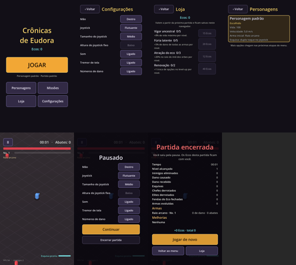
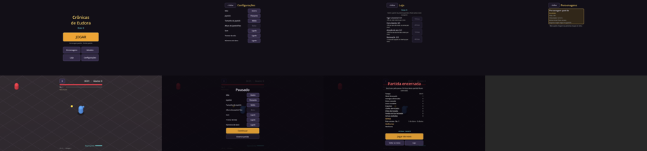

# Relatório da 0.5-alpha, Parte 1: menu inicial

| | |
|---|---|
| **Data** | 27/11/2026 |
| **Versão do jogo** | 0.5-alpha em construção (Parte 1 de 4). Sem mudança de equilíbrio, conteúdo ou progressão |
| **Branch** | `claude/bold-clarke-aixtws` (a partir do `main` `baea23d`, que tem a manutenção pós-0.4 do PR #12) |
| **Pull Request** | https://github.com/ederkm40/Cronicas-de-Eudora/pull/14 |
| **Prévia** | https://ederkm40.github.io/Cronicas-de-Eudora/previews/pr-14/ |

## Objetivo

Parte 1 do menu, aprovada pelo proprietário:

- tela inicial com título, Ecos e JOGAR, mais Personagens, Missões, Loja e Configurações;
- "voltar" em todas as telas, inclusive o do celular, cabendo em pé e deitado;
- o mesmo painel de configurações na pausa e no menu;
- loja no menu;
- "Jogar de novo" e "Voltar ao menu" nos resultados;
- um pacote com a escolha (personagem e missão) entregue à partida, por enquanto só com os atuais.

O proprietário também relatou que **não encontrou o botão de pausa**.

## O botão de pausa

- **Causa:** o botão "II" existia (canto de cima, do lado oposto ao polegar), mas usava o estilo padrão do Godot: cinza-escuro sobre o chão cinza-escuro, 76 × 64. Uma captura da versão oficial (Chromium com tela de Pixel 7) confirmou que ele parecia um enfeite.
- **Correção:** fundo roxo, borda clara de 2 px, cantos arredondados, 92 × 76, fonte 34 (`UiStyle`). Um teste confere tamanho, borda e contraste da borda com o chão.
- **Bônus:** o voltar do celular agora também abre a pausa.

## Mudanças

| O quê | Como |
|---|---|
| Menu (`MainMenu`, `scenes/menu.tscn`) | cena inicial do jogo. JOGAR dourado de 150 de altura, com um brilho lento; 4 botões em grade 2 × 2; uma tela visível por vez |
| Voltar (`BackNavigation`) | Esc, voltar do Android e voltar do navegador. No menu volta à inicial; na partida abre ou fecha a pausa; no level-up e nos resultados não faz nada |
| Voltar do navegador | antes **saía da página do jogo**. Agora o jogo cria uma entrada no histórico no primeiro toque e a repõe a cada voltar |
| Configurações (`SettingsPanel`) | o mesmo painel na pausa e no menu, gravando o mesmo arquivo |
| Loja (`ShopPanel`) | a mesma loja no menu e nos resultados |
| Resultados | Jogar de novo, Voltar ao menu e Loja |
| Pausa | Continuar e **Encerrar partida**, que pede um segundo toque. Encerrar conta como derrota (os Ecos da partida contam) e mostra "Partida encerrada" |
| Pacote da partida (`RunSetup`) | personagem e missão escolhidos (`padrao`/`padrao`); "Jogar de novo" repete a escolha |
| Personagens e Missões | mostram a opção atual, com números do código (vida 100, 5,0 m/s, Raio arcano, chefe aos 10:00), e o aviso "Mais opções chegam nas próximas etapas do menu" |

Detalhes técnicos: `docs/TECNICO.md` (seção "0.5-alpha, Parte 1") e decisão 0014.

## Capturas (Godot 4.7.2 com Xvfb e Mesa, não é um celular)

Em pé (720 × 1280): início, configurações, loja, personagens, partida (botão de pausa novo), pausa e resultados de "Encerrar partida".

Deitado (1280 × 600): as mesmas telas, numa coluna central.

## Arquivos

- Novos: `scenes/menu.tscn`, `scripts/main_menu.gd`, `scripts/back_navigation.gd`, `scripts/settings_panel.gd`, `scripts/shop_panel.gd`, `scripts/run_setup.gd`, `scripts/ui_style.gd` (com os `.uid`), `tests/suites/menu.gd`, `tools/e2e/testes/menu.spec.js`.
- Alterados: `project.godot` (cena inicial), `scripts/main.gd`, `scripts/pause_menu.gd`, `scripts/results_screen.gd`, `scripts/hud.gd`, `scripts/web_bridge.gd`, `tests/run_tests.gd`, `tests/smoke_test.gd`, `tools/e2e/testes/ajudantes.js`, `tools/e2e/testes/jogabilidade.spec.js`, `tools/e2e/playwright.config.js`.
- Documentação: `docs/TECNICO.md`, decisão 0014 (e a linha no índice), `docs/IA/*`, `docs/ROADMAP.md`, Documento Mestre (seção 27.1).

## Testes e resultados (locais, Godot 4.7.2 headless)

| Verificação | Resultado |
|---|---|
| `gdlint scripts tests` | `Success: no problems found` |
| `gdformat --check` (arquivos alterados) | sem pendências |
| `run_tests` | 86 testes, 4.704 verificações, 0 falhas (13 novos na suíte `menu.gd`) |
| `smoke_test` | `SMOKE TEST: OK` (agora abre o menu e toca em JOGAR) |
| `long_simulation` (300 s) | `SIMULAÇÃO LONGA: OK`; média 1,85 ms, p95 4,75 ms, p99 6,81 ms |
| Wiki e montagem do site | OK |
| Playwright no CI (commit `8b62994`), Mesa/llvmpipe nos 3 perfis | build QA: **33 aprovados**, 3 pulados de propósito (eram 24; +9 = 3 testes do menu × 3 perfis). Build de produção: 11 aprovados, 1 pulado |
| Prévia | publicada e **verificada no ar** pelo workflow (commit `8b62994`) |

Testes novos da suíte `menu.gd`: abre na inicial com os Ecos; navegação, Voltar e Esc; voltar do Android; personagem e missão com números do código; configuração do menu vale na partida; configuração da pausa aparece no menu; compra no menu vale na partida (108 de vida com Vigor 1); JOGAR abre a partida com a escolha (só uma, mesmo com dois toques); Voltar ao menu pelos resultados; Encerrar com confirmação; voltar do celular na partida (e não no level-up); botão de pausa visível; tela inicial cabe em pé.

Playwright (`menu.spec.js`), nos 3 perfis: telas e Voltar por toque, e o voltar do navegador sem sair da página; canhoto e compra no menu valendo na partida, Encerrar com dois toques e Voltar ao menu; voltar do navegador pausando e retomando a partida. Todos os testes antigos de jogabilidade agora abrem a partida tocando em JOGAR.

## Problemas e limitações

- Não testado em celular físico. As capturas vêm do Godot com renderização por software.
- No navegador, o voltar só é interceptado depois do primeiro toque na página (regra do Chrome). Antes disso, ele sai da página, como antes.
- Personagens e Missões ainda não têm escolha: só a opção atual. Os catálogos vêm nas partes 2 e 3.
- Na tela deitada, as telas ficam numa coluna central e pequenas, como o resto da interface.
- No fim dos testes aparece o aviso "2 ObjectDB instances leaked" (`AudioStreamWAV` do cache de sons da 0.4). Ele não vem do menu.

## Commit e PR

Código em `e13f586`, mais a junção com o histórico da branch (sem mudar arquivos) e a documentação. PR #14.
